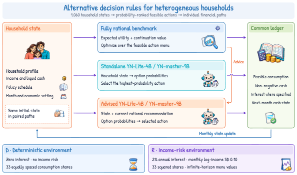

# S²-MAS: A Society-Scale Multi-Agent Simulation Framework with a 500-Million-Persona Resource

S²-MAS combines a reusable population resource, learned decision policies and explicit financial accounting. The **YN family** comprises YN-mini, YN-Lite-4B and YN-master-9B, with suffixes identifying training variants and execution formats.

- **500M synthetic household personas** form the population resource.
- **12M distinct households** completed a paired purchase-funding application: 24M one-shot choices and 288M monthly ledger states in 3 h 59 min 17 s on 14 GPUs (8 H100 and 6 A100).
- **74.55% accuracy and 38.37% question-macro F1** for YN-mini-MLX on the 240,458-record common consumer-choice test.
- **1,060-household consumption experiment:** standalone 4B/9B policies, fully rational benchmarks, advice variants, group MAE, information-timing interventions and paired consumption–cash responses. Standalone 9B's annual MAE is 3.42% lower than the deterministic rational benchmark's, while its population mean is 19.7% below observed consumption.

[Latest paper](paper/S2_MAS_Paper.pdf) · [LaTeX and figures](paper/) · [Reported aggregates](paper/source_data/) · [中文](README_ZH.md)

Manuscript v67 · 28 October 2026 · 56 pages · 13 main figures and 8 supplementary figures · [arXiv:2610.27746](https://arxiv.org/abs/2610.27746).

| Resource | Entry point and scope |
|---|---|
| Paper and scientific scripts | [Paper resources](paper/README.md), [aggregate figure code](paper/figure_code/) and [decision-model training and evaluation](reproduction/training/README.md) |
| Decision models | [Model catalog](resources/MODEL_CATALOG.md) and [YN model collection](https://huggingface.co/collections/ya9919/s-mas-models-sharp); existing repository slugs remain valid |
| Synthetic companion | [Generation code, schema and terms](resources/public_companion/README.md); 2M independently constructed financial personas and 32k unlabelled inputs; [dataset](https://huggingface.co/datasets/ya9919/s2-mas-synthetic-household-companion) |
| Wikidata component | [CC0 knowledge files](resources/wikidata/README.md): 38 entities and 66 parent/type relations |

The 500M resource, 12M executed cohort and independently generated public companion have distinct roles. The controlled state-writeback benchmarks run up to 1,000 agents; the population application measures the preparation–inference–ledger pipeline. Reported decision throughput counts input tokens processed, not generated output tokens.

Public scientific plotting, training and evaluation scripts use [Apache-2.0](LICENSE). The GENESE/MAS engine implementation remains private. Companion data use [research-use data terms](resources/public_companion/LICENSE-DATA.md); Wikidata remains [CC0](resources/wikidata/LICENSE-CC0.md). Project models use [controlled research terms](resources/models/LICENSE-CONTROLLED-RESEARCH.md).

Research contact: [yl9919@connect.hku.hk](mailto:yl9919@connect.hku.hk).
