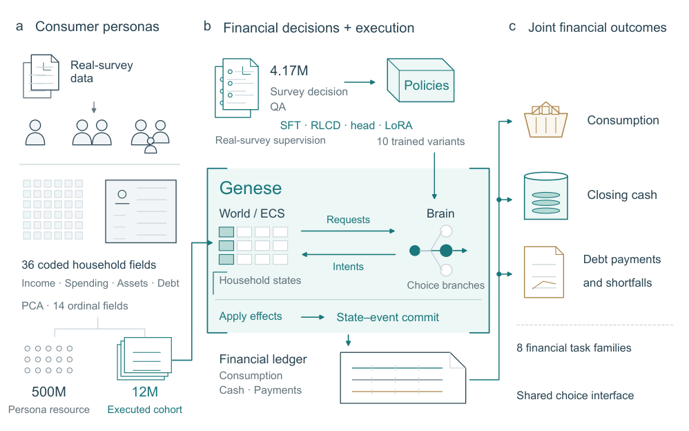
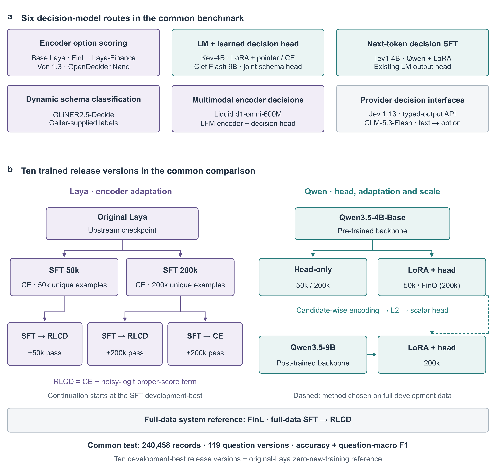
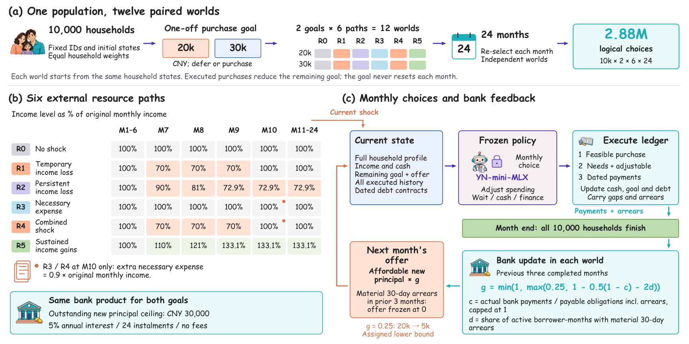

# S²-MAS: A Society-Scale Multi-Agent Simulation Framework with 500 Million Household Persona Agents

**5 亿家庭 persona、36 个字段，6 条决策模型路线、10 个训练发布版本、15 个模型的场景内共同测试。** S²-MAS 把可复用的家庭选择任务接入月度金融状态演化。14 个模型完成 one-shot 全量测试，GPT-6-Astra 在同一固定分组样本上配对比较。

在本文比较且披露训练规模的金融决策模型中，sharp-421m 使用**规模最大的SFT + RLCD 训练集：2,925,263 条训练样本**。S²-MAS 完成了 **1,200 万个不同合成家庭 agent 的配对条件模拟，是本文比较的已完成模型驱动 MAS 模拟中参与 agent 数量最多的一项**。

- **Accuracy 74.5544% · Macro-F1 38.3746%**：共同测试含 240,458 条记录、119 个题目版本、8,275 个组。
- **9.10 ms · 相对 Jev API 加速 22.72 倍 · 相对同 checkpoint 的 PyTorch 加速 2.42 倍**：sharp-322m-mlx，3 个固定中文输入，每组 60 次计时，batch 与并发均为 1，本地模型使用单张 A100 PCIe 40GB；包含输入准备与同步预测／API 往返。

**完整规模运行：1,200 万个不同 agent · 2,400 万条配对条件选择 · 2.88 亿个账本状态 · 3 小时 59 分 17 秒 · 14 张 GPU（8 张 H100 80GB + 6 张 A100 40GB）。**

[最新论文](paper/S2_MAS_Paper.pdf) · [LaTeX 与论文图](paper/) · [已报告聚合结果](paper/source_data/) · [English](README.md)

论文 v56 · 2026 年 10 月 22 日 · [arXiv:2610.27746](https://arxiv.org/abs/2610.27746)。

| 资源 | 入口与范围 |
|---|---|
| 论文与科研脚本 | [论文、聚合数据与绘图复现](paper/README.md)和[训练／评测脚本](reproduction/training/README.md) |
| 决策模型 | [17 个仓库的模型目录](resources/MODEL_CATALOG.md) · [sharp 模型合集](https://huggingface.co/collections/ya9919/s-mas-models-sharp)：区分十个训练发布版本、具名checkpoint、运行格式与一个兼容入口 |
| 合成配套 | [生成代码、结构与条款](resources/public_companion/README.md)；含 200 万个独立构造的金融 persona 与 32,000 条无标签输入，完整数据的分发入口为 [Hugging Face](https://huggingface.co/datasets/ya9919/s2-mas-synthetic-household-companion) · [数据资源合集](https://huggingface.co/collections/ya9919/s-mas-dataset-resources) 与 [GitHub Release](https://github.com/KataDavidXD/s2-mas/releases) |
| Wikidata 组件 | [实际 CC0 知识文件](resources/wikidata/README.md)：38 个实体、66 条父级／类型关系，用于赋值语境 |

下图展示框架、决策模型训练路线及条件冲击应用。

合成配套与 Wiki 语境独立于论文的 1,200 万执行 cohort 及其五冲击月度扩展，也没有用于既有模型训练。标题的 5 亿指框架的 persona 资源规模。

公开的科研绘图、训练与评测脚本采用 [Apache-2.0](LICENSE)。**GENESE 引擎实现保持私有。**配套记录采用[研究用途数据条款](resources/public_companion/LICENSE-DATA.md)；Wikidata 知识保持 [CC0](resources/wikidata/LICENSE-CC0.md)，已有原创任务设计保持 CC BY 4.0。项目模型贡献采用[受控科研条款](resources/models/LICENSE-CONTROLLED-RESEARCH.md)：非商用、禁止再分发和未经授权的逆向。

科研合作：[yli9919@hku.hk](mailto:yli9919@hku.hk)。

[Blog](https://huggingface.co/blog/ya9919/s2-mas) · [双海报与引擎对照页](publicity/20261021_sharp/)
